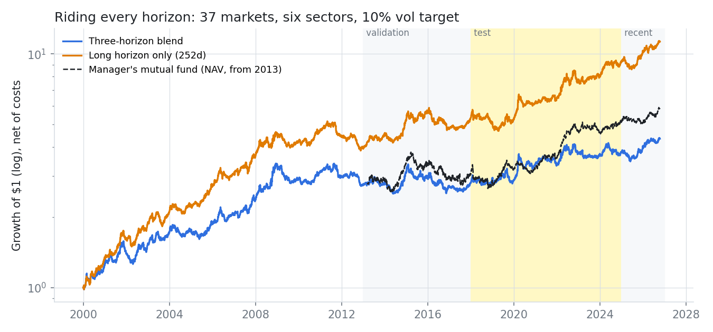
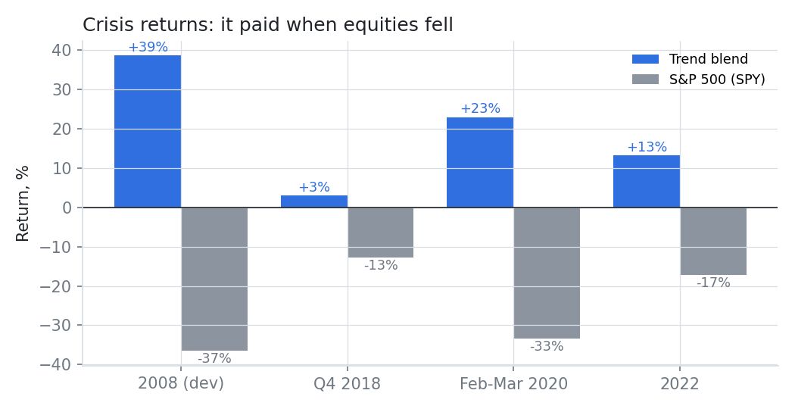
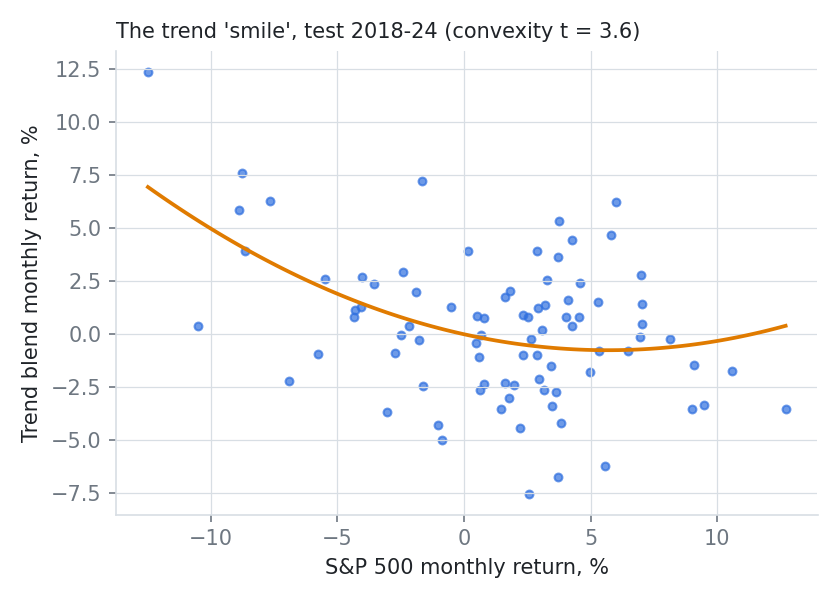
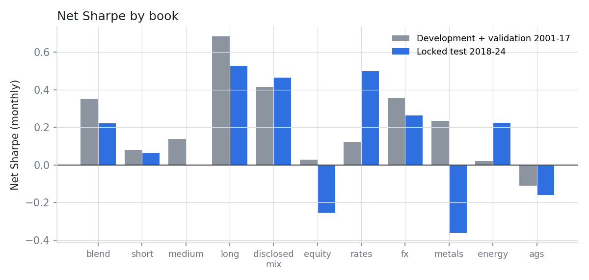

# Riding Every Horizon

### Does a trend-following programme rebuilt only from its SEC disclosure really pay in crises, out of sample, after costs?


> **TL;DR.** A long-running systematic manager tells investors, in its fund's annual report, that it trades
> "predominantly trend-following" models at short, medium and long horizons across six sectors. We rebuilt that
> design on 37 futures markets with free data, froze three hypotheses, and opened a locked 2018-24 test only
> afterwards. **It paid in every crisis: +23% in the 2020 crash (S&P 500 -33%) and +13% in 2022 (S&P -17%), with
> crisis convexity t = 3.6.** Its average return was not significant (Sharpe 0.22), and the slow 12-month signal
> alone (0.53) beat the three-horizon blend. It tracks the manager's own mutual fund at a 0.52 monthly correlation.



---

## 1. The research: what the filing says

Source: Form N-CSR (annual report) of a managed-futures mutual fund whose futures book is run by a systematic
manager with a decades-long trend-following record (fiscal year to 30 Sep 2019). Quotes are verbatim; the full
table and citation are in [`research/institutional_methodology.md`](research/institutional_methodology.md).

| | Quote |
|---|---|
| Style | *"a diversified intermediate to long-term multi-strategy (but predominantly trend-following) approach"* |
| Universe | *"market exposure continues to be diversified across six sectors"*: currencies 37.7%, interest rates 24.6%, equity indices 20.9%, agriculturals 7.6%, metals 6.1%, energy 3.1% |
| Horizons | *"medium- and long-term trend models"* and *"short-term momentum (<30-day holding period)"* |

The filing is the **only** information we use about the manager. Everything else comes from public research.

## 2. The gap

Trend following is sold on two promises, *crisis alpha* and *diversification across horizons*. Testing them openly is
harder than it looks:

| What is missing | Why it matters |
|---|---|
| **Free-data replications that keep carry.** Continuous front-month futures (Yahoo) jump at every roll by the calendar spread. For bond and currency futures that spread *is* the carry, so naive backtests silently delete it. | Our first run lost money on bonds during the 2001-12 bond bull market. That was the bug, not the strategy. |
| **Realistic, per-contract costs.** Flat "x bp per trade" assumptions charge a 2-year Treasury future, which needs ~25x notional to reach 40% vol, about 10x its real cost. | The cost model decides whether fast signals survive. |
| **A test against the real manager.** Academic studies (Moskowitz, Ooi & Pedersen 2012; Hurst, Ooi & Pedersen 2017) use generic trend factors; few compare a disclosed design with the manager's own NAV. | Without it you cannot tell a replication from a story. |
| **A locked out-of-sample test.** Most trend backtests are tuned on the same history they report. | Over-fitting horizons and weights is the default failure mode. |

## 3. Our solution

```mermaid
flowchart LR
    A["SEC N-CSR<br/>6 sectors, 3 horizon types"] --> B["Free data<br/>Yahoo futures, FRED yields + FX + rates"]
    B --> C["Clean + carry-correct<br/>roll-gap filter, synthetic bond and FX excess returns"]
    C --> D["Signals<br/>tanh(t-stat) of 21 / 63 / 252-day returns"]
    D --> E["Risk<br/>40% vol per market, equal risk per sector, 10% portfolio target"]
    E --> F["Execution<br/>10% no-trade band, half-tick + commission, roll costs"]
    F --> G["Pre-register + freeze<br/>hash 2cca1fec34d9"]
    G --> H["Locked test 2018-24<br/>bootstrap, convexity, fund comparison"]
```



| Design choice | What we did | Why |
|---|---|---|
| Carry-correct bonds | Constant-maturity par Treasuries from FRED yields, repriced daily, minus the T-bill | A rolled bond future earns this; Yahoo front-month series do not |
| Carry-correct FX | FRED spot + OECD 3-month rate differential (covered interest parity), rates lagged one month | Same reason, for currency futures |
| Data cleaning | 35 values changed, all logged: non-positive prices, one-day bad prints, unconfirmed commodity roll gaps. Real shocks (SNB 2015, Brexit, Feb 2018, oil Mar 2020) are kept | A first, cruder filter deleted real crashes and was rejected |
| Signal | tanh of the trailing-return t-statistic, not its sign | Sign signals flip on noise near zero; this cut turnover by about 4x |
| Costs | Half a tick + $2 per contract at 2024 prices, x1.5 slippage, plus two trades per roll | Cost drag 1.4%/yr for the blend |
| Timing | Signal on the close of day t, position held over t+1 | Checked by a look-ahead unit test |

## 4. Results (locked test 2018-24, 84 months, net of costs)

| | Pre-registered claim | Result | Verdict |
|---|---|---|---|
| **H1** | The three-horizon blend has a positive Sharpe | 0.22, 95% CI [-0.40, 0.75], p = 0.23 | Not supported |
| **H2** | The blend beats the best single horizon | -0.31 vs the 12-month horizon, p = 0.91 | Not supported (predicted from dev data) |
| **H3** | Crisis convexity (returns smile against the S&P 500) | t = 3.60, p = 0.0002 | **Supported** |
| Gate | Correlation with the manager's own fund >= 0.50 | **0.52** | Passed |

|  |  |
|---|---|

**Crisis returns (total return):** 2008 +38.5% (development period), Q4 2018 +3.0%, 19 Feb-23 Mar 2020 +22.9%,
2022 +13.2%. The 2020 gain came from long Treasuries (+8.6 pp) and short energy (+6.5 pp).

| Book (test) | Return/yr | Vol | Sharpe [95% CI] | Max DD |
|---|---|---|---|---|
| Three-horizon blend | 2.6% | 11.7% | 0.22 [-0.52, 0.96] | -18.6% |
| 12-month horizon only | 6.1% | 11.6% | 0.53 [-0.22, 1.27] | -18.0% |
| Disclosed sector mix | 5.4% | 11.7% | 0.46 [-0.28, 1.21] | -12.7% |



**Does it look like the real thing?** Monthly correlation with real fund NAVs over the test: the manager's own fund
0.52, three other large managed-futures funds 0.68-0.73, and the S&P 500 -0.37.

## 5. What we learned

1. **Crisis alpha is real and robust out of sample.** All four equity crises in the sample had positive trend returns.
2. **The average premium is modest and noisy.** Seven years is not enough to prove a 0.2-0.5 Sharpe.
3. **Horizon diversification did not help.** The 12-month signal carried the premium in every period; fast signals
   paid 2.5%/yr in costs and earned it back only in crashes.
4. **Data engineering is half the result.** Restoring bond and FX carry turned the rates book from -0.15 to +0.28 Sharpe
   in development. Free-data backtests that skip this step are wrong, not just noisy.

## 6. How we kept it honest

* **Pre-registration** ([`research/preregistration.md`](research/preregistration.md)) frozen with SHA-256 prefix
  `2cca1fec34d9`; the code (`qcore.splits.guard`) refuses to load 2018+ data until `PREREG_HASH` matches it.
* **Experiment log** ([`research/experiment_log.md`](research/experiment_log.md)) lists every design change made on
  2001-17 data, including the ones that failed and the one (carry) that a poor result prompted.
* **Look-ahead test** ([`tests/test_lookahead.py`](tests/test_lookahead.py)): shocking all data after a date must
  leave every earlier weight unchanged.
* **Negative results are reported in full.** Two of three hypotheses failed.

## 7. Reproduce

```bash
pip install -e ./qcore -e .
python scripts/run.py download && python scripts/run.py build    # free: Yahoo + FRED
python scripts/run.py dev                                        # development + validation only
PREREG_HASH=2cca1fec34d9 python scripts/run.py test              # the locked test
PREREG_HASH=2cca1fec34d9 python scripts/figures.py
pytest
```

## 8. Repository map

```
configs/        universe (37 markets, per-contract costs), strategy (frozen parameters), period splits
src/trend/      data.py (download, cleaning), macro.py (carry-correct bonds + FX), model.py, analysis.py
scripts/        run.py (download / build / dev / test), figures.py
research/       institutional_methodology, preregistration, experiment_log, results, limitations, sources/
results/        figures/, tables/ (summaries, fund correlations, crisis returns)
qcore/          shared helpers: period splits with the test lock, metrics, stationary bootstrap
tests/          look-ahead and signal tests
```

**Limitations** ([full list](research/limitations.md)): commodity series still miss roll yield; bonds are US-only
synthetic; costs are estimated, not measured; one 84-month test window; not the manager's actual model.

**References:** Moskowitz, Ooi & Pedersen (2012) *Time Series Momentum*, JFE · Hurst, Ooi & Pedersen (2017) *A Century
of Evidence on Trend-Following Investing*, JPM · Baltas & Kosowski (2013) *Momentum Strategies in Futures Markets and
Trend-Following Funds* · Politis & Romano (1994) *The Stationary Bootstrap*.

*Research artifact, not investment advice.*
